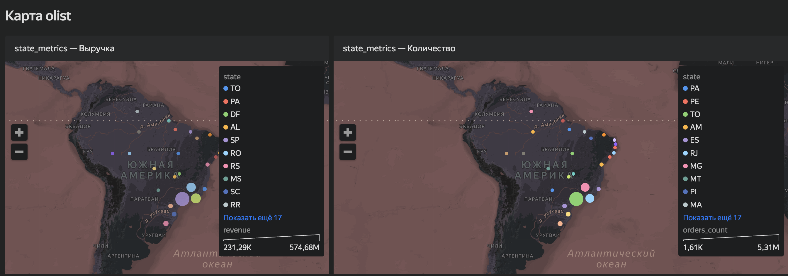

# E-commerce Analytics: Olist Marketplace

Сквозной аналитический проект на реальных данных бразильского маркетплейса **Olist**: 100k+ заказов, 8 связанных таблиц. Полный цикл продуктовой аналитики — от валидации данных до дизайна A/B-теста.

**Стек:** PostgreSQL · Python (pandas, numpy, scipy, statsmodels) · SQLAlchemy · Yandex DataLens · Redash

---

## TL;DR

- **~75% выручки** дают 12 категорий класса A — и все они в XYZ-классе **Z** (непредсказуемый спрос) → нужен динамический подход к запасам, а не плановые закупки.
- **Повторно покупают ~3% клиентов** (RPR = 2.96%) — маркетплейс живёт на разовом трафике; удержание — главная точка роста.
- RFM-сегментация выделила **Champions** (1.2k клиентов, самый высокий средний чек) и крупный сегмент **Big Spenders at Risk** (13k клиентов, ~2.8 млн BRL выручки) — приоритет для реактивации.
- Спроектирован A/B-тест на Repeat Purchase Rate: MDE +15% → **~24.5k пользователей на группу**, доступно ~43k; рандомизация внутри штатов, SRM-check p = 0.77.

---

## Структура

```
olist-ecommerce-analysis/
├── sql/          # 20+ запросов: метрики, воронка, доставка, когорты, оконные функции
├── notebook/     # metrics.ipynb — основной анализ в Python (блоки 0–3)
└── data/         # скриншот дашборда DataLens
sql_analysis.md   # все SQL-запросы с результатами
```

## Блок 0 — Подготовка и качество данных

- Загрузка 8 таблиц из PostgreSQL через SQLAlchemy
- Профилирование: типы, уникальные значения, доля NULL по каждой таблице
- Целостность: заказы без оплат, дубликаты `order_id`
- Отсечение выбросов цены (IQR внутри каждой категории) и сроков доставки
- Выручка по месяцам: абсолютный и MoM-прирост; MAU

## Блок 1 — Продуктовое ядро

- ABC-анализ категорий по выручке (кривая Парето)
- XYZ-анализ: коэффициент вариации месячного спроса
- Матрица ABC-XYZ
- Геоаналитика по штатам → карта в DataLens

## Блок 2 — Клиентская аналитика (RFM)

- RFM на уровне `customer_unique_id` (а не `customer_id`, который уникален для каждого заказа)
- R и M — квинтили, F — бинарный (разовая / повторная покупка): из-за низкой доли повторных покупок квинтили по F вырождаются
- Сегменты: Champions, Low-Value Repeat, Potential Loyalists, New Customers, Big Spenders at Risk, Lost, Regular

## Блок 3 — Дизайн A/B-теста

- Целевая метрика — Repeat Purchase Rate (обоснование вместо review_score и конверсии)
- Baseline RPR = 2.96%, MDE +15% relative, α = 0.05, power = 0.8 → 24 530 пользователей на группу
- Рандомизация с блокировкой по `customer_state` (случайное назначение внутри каждого штата), SRM-check (χ², p = 0.77)

## SQL-часть

Выручка и заказы по месяцам, топ-10 категорий и продавцов, способы оплаты, воронка статусов, время доставки по штатам, новые vs вернувшиеся покупатели, ранжирование продавцов внутри категорий (`RANK() OVER`), накопительная выручка. Все запросы — в [`sql/`](olist-ecommerce-analysis/sql) и [`sql_analysis.md`](sql_analysis.md).

## Дашборд



## Как запустить

1. Скачать датасет: [Brazilian E-Commerce Public Dataset by Olist (Kaggle)](https://www.kaggle.com/datasets/olistbr/brazilian-ecommerce)
2. Создать таблицы: `olist-ecommerce-analysis/sql/create_tables.sql`, загрузить CSV
3. Указать строку подключения в первой ячейке `metrics.ipynb` и запустить ноутбук
